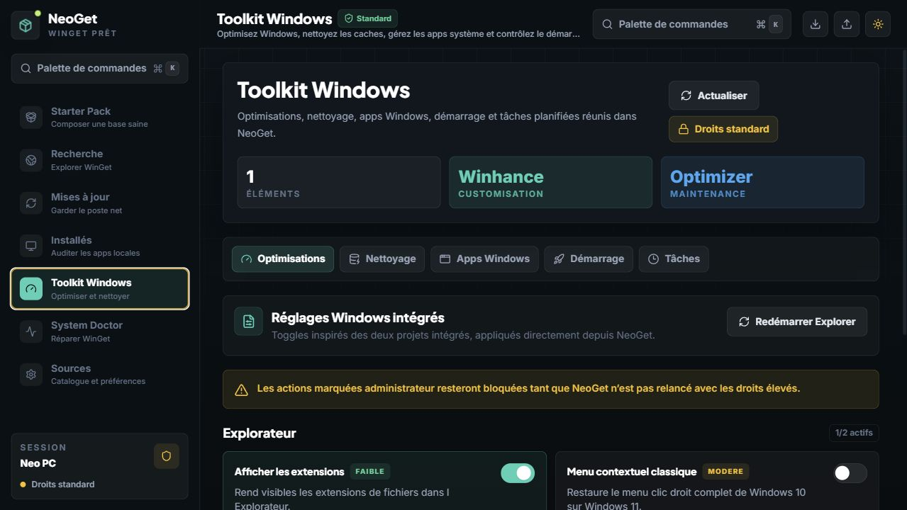

<div align="center">

# 🚀 NeoGet

### *Le Cockpit Windows Ultime pour WinGet, le Nettoyage et l'Optimisation Système*

NeoGet rassemble le gestionnaire de paquets WinGet, le diagnostic système en temps réel et un toolkit d'optimisation Windows au sein d'une application desktop **Tauri v2** moderne, ultra-rapide et 100 % locale.

<br />

[](releases/NeoGet-Setup-2.3.2-x64.exe)
[](https://react.dev)
[](https://tauri.app)
[](https://www.rust-lang.org)
[](https://www.typescriptlang.org)
[](https://learn.microsoft.com/windows/package-manager/winget/)
[](LICENSE)

<br />

<p>
  <a href="releases/NeoGet-Setup-2.3.2-x64.exe"><strong>⚡ Télécharger l'installateur Windows (.exe)</strong></a>
  ·
  <a href="docs/SETUP.md"><strong>📘 Guide Dev</strong></a>
  ·
  <a href="docs/ARCHITECTURE.md"><strong>🏗️ Architecture</strong></a>
  ·
  <a href="docs/CHANGELOG.md"><strong>📝 Changelog</strong></a>
</p>

<br />



</div>

---

## ✨ Pourquoi NeoGet ?

Configurer ou maintenir un poste Windows propre exige généralement l'utilisation conjointe de multiples terminaux, de scripts PowerShell épars, du planificateur de tâches et du registre Windows. 

**NeoGet unifie l'intégralité de ces flux** au sein d'un tableau de bord unique, élégant et sécurisé sans aucune télémétrie ni dépendance cloud.

| Cas d'usage | Ce que NeoGet apporte |
| --- | --- |
| **📦 Installation initiale** | Catalogue *Starter Pack* structuré par métiers, panier multi-sélection et déploiement groupé. |
| **🔍 Recherche universelle** | Exploration directe du catalogue officiel WinGet avec ajout en un clic au panier d'installation. |
| **🔄 Maintenance applicative** | Scanner de versions obsolètes et ajouter les mises à jour à une file d'opérations suivie par le backend. |
| **🧹 Nettoyage système** | Analyse et purge ciblée des caches temporaires, prefetch, miniatures et résidus Windows Update. |
| **⚡ Optimisation & Tweaks** | Toggles instantanés : menu contextuel classique, masquage des Widgets/Copilot, Game DVR, hibernation et extensions. |
| **🚀 Contrôle du démarrage** | Audit et activation/désactivation des programmes au démarrage et tâches planifiées non-Microsoft. |
| **🩺 Doctor WinGet** | Diagnostic RAM, Disque, OS & réinitialisation des répertoires/sources WinGet corrompus. |

---

## 🎨 Vues Principales & Fonctionnalités

### 1. Starter Pack & Recherche WinGet
- **Sélection rapide** : Outils indispensables catégorisés (Navigateurs, Dev, Multimédia, Bases de données, Productivité).
- **Panier dynamique** : Préparation d'une file d'attente d'installation avec suivi de progression en overlay minimisable.
- **Import / Export JSON** : Sauvegarde et restauration instantanée de configurations logicielles.
- **File d'opérations fiable** : Installations, mises à jour et désinstallations sont mises en file par le backend. Une même action sur un même paquet n'est exécutée qu'une fois à la fois.

### 2. Centre de Mises à jour & Inventaire
- **Inventaire local complet** : Listing et filtrage rapide parmi toutes les applications installées sur la machine hôte.
- **Upgrades intelligents** : Mises à jour individuelles ou groupées, avec détection des paquets sans version connue et mode forcé pour la maintenance complète.
- **Désinstallation sécurisée** : Boîte de dialogue de confirmation obligatoire pour éviter toute suppression involontaire.

### Suivi des opérations
- **État unique côté backend** : Chaque opération passe par `queued`, `running`, `success` ou `failed` avec un identifiant, des horodatages et le détail d'erreur utile.
- **Exécution séquentielle** : WinGet reçoit une opération à la fois afin d'éviter les conflits entre installations, mises à jour et désinstallations.
- **Interface synchronisée** : L'overlay lit l'état initial, écoute les événements Tauri et rafraîchit l'état pendant qu'une opération est active. Il reste cohérent après une réponse tardive ou un événement manqué.

### 3. Toolkit Windows
- **Explorateur** : Afficher extensions, fichiers cachés, vue compacte, menu clic-droit classique Windows 10/11.
- **Confidentialité & Gaming** : Masquer Widgets, désactiver Game DVR, désactiver Windows Copilot, réduire les suggestions.
- **Nettoyeur de caches** : Purge sécurisée du dossier Temp, Prefetch, Cache Windows Update et miniatures Explorer.
- **Gestionnaire AppX & Démarrage** : Désinstallation propre des paquets UWP/AppX amovibles et contrôle du démarrage système.

### 4. System Doctor & Gestion des Sources
- **Capteurs système** : Visualisation en temps réel de la consommation mémoire RAM et de l'espace disque libre.
- **Restauration WinGet** : Profils de maintenance intégrés. Les profils rapide et complet mettent à jour les sources, analysent les mises à jour puis les ajoutent à la file. Le profil de réparation réinitialise les sources WinGet.

---

## 🚀 Prise en main rapide

### 1. Installer NeoGet
Téléchargez l'installateur Windows puis exécutez-le :

```powershell
.\releases\NeoGet-Setup-2.3.1-x64.exe
```

Le binaire portable est aussi disponible dans `releases\NeoGet-2.3.1-x64.exe`.

> **Note** : Pour appliquer les optimisations système avancées du Toolkit Windows, exécutez NeoGet avec les privilèges administrateur (`Clic-droit -> Exécuter en tant qu'administrateur`).

### 2. Environnement de Développement

#### Prérequis
- Windows 10 ou 11
- WinGet fonctionnel
- Node.js (v18+)
- Rust & Cargo (v1.75+)

#### Installation & Lancement
```powershell
# 1. Cloner le dépôt
git clone https://github.com/neosoda/NeoGet.git
cd NeoGet

# 2. Installer les dépendances JavaScript
npm install

# 3. Lancer le mode développement desktop avec Hot-Reload
npm run tauri:dev
```

#### Compilation Release
```powershell
# Compiler le binaire optimisé Tauri v2
npm run tauri:build
```

Les chemins de sortie suivent la configuration Cargo du projet. Consultez `.cargo\config.toml` si le dossier `target` a été déplacé.

---

## 🏗️ Architecture & Stack Technique

```text
NeoGet/
├── src/                                # Frontend React 19 + TypeScript
│   ├── App.tsx                         # Layout shell & gestionnaires globaux
│   ├── components/                     # Composants UI (Grid, Toolkit, Doctor, Cart, Palette)
│   ├── hooks/                          # Hooks d'état (Panier, Thème, Status, Installation)
│   └── index.css                       # Design System Tailwind CSS & Tokens HSL
├── src-tauri/                          # Backend Rust & Tauri v2
│   ├── src/commands.rs                 # Invocations système, WinGet & PowerShell
│   ├── src/operations.rs               # File, déduplication et état des opérations WinGet
│   ├── src/lib.rs                      # Enregistrement des IPC Handlers & Logger
│   └── tauri.conf.json                 # Configuration Tauri v2 & CSP
├── releases/                           # Artifacts Release vérifiés
│   ├── NeoGet-2.3.1-x64.exe            # Binaire portable
│   ├── NeoGet-Setup-2.3.1-x64.exe      # Installateur NSIS
│   └── SHA256SUMS.txt                  # Empreintes SHA-256
├── software.json                       # Catalogue Starter Pack par défaut
└── package.json                        # Configuration NPM & scripts de build
```

| Couche | Technologie |
| --- | --- |
| **Interface UI** | React 19, TypeScript, Tailwind CSS, Framer Motion, Lucide Icons |
| **Desktop Runtime** | Tauri 2.0 (Rust) |
| **Moteur Système** | Rust (Tokio async), PowerShell, WinGet CLI |
| **Build System** | Vite, Cargo |

---

## 🛡️ Sécurité & Confidentialité

- **100 % Local** : Aucune donnée personnelle, statistique ou télémétrie n'est envoyée vers un serveur tiers.
- **Transparence IPC** : Toutes les commandes exécutées passent par les API typées et sécurisées de Tauri v2.
- **Traçabilité** : Les opérations enregistrent leur type, paquet, commande, durée et erreur éventuelle dans les logs locaux de NeoGet.
- **Sécurité UAC** : Les opérations nécessitant une élévation de privilèges sont clairement signalées dans l'interface et verrouillées si les droits sont insuffisants.

---

## ✅ Vérification avant publication

```powershell
cargo test --manifest-path src-tauri\Cargo.toml
npm test
npm run build
npm run tauri:build
Get-FileHash .\releases\NeoGet-2.3.1-x64.exe -Algorithm SHA256
```

---

## 📖 Documentation Complète

- 🏗️ [Architecture Technique](docs/ARCHITECTURE.md)
- 💻 [Guide de Configuration Dev](docs/SETUP.md)
- 🎨 [Design System & UI Tokens](docs/DESIGN_SYSTEM.md)
- 📝 [Journal des Modifications (Changelog)](docs/CHANGELOG.md)

---

## 📄 Licence

Ce projet est sous licence [MIT](LICENSE).

<br />

<div align="center">

*Fait avec ❤️ avec React, Rust, Tauri et WinGet.*

</div>

