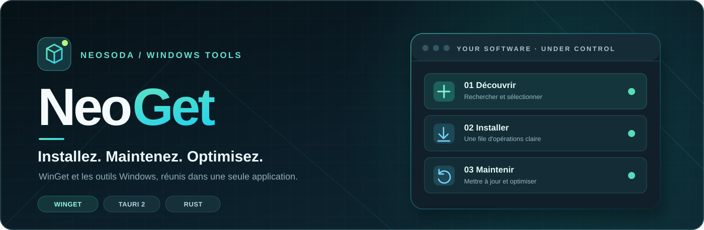

 

**Le centre de contrôle de vos logiciels et de votre Windows.**

Installez vos applications, gardez-les à jour et prenez soin de votre système — depuis une interface unique, rapide et pensée pour le quotidien.

 

 

 

**[Fonctionnalités](#-tout-ce-quil-faut-pour-garder-windows-au-propre)** · [**Téléchargement**](#-télécharger-neoget) · [**Développement**](#-développement) · [**Documentation**](#-documentation)

---

## Une seule application. Moins de friction.

Installer dix logiciels après une réinstallation Windows, rechercher les mises à jour, supprimer des applications ou ajuster les paramètres système : tout cela ne devrait pas demander dix outils différents.

**NeoGet** réunit la puissance de **[Microsoft WinGet](https://learn.microsoft.com/windows/package-manager/winget/)** et un véritable **toolkit Windows** dans une application desktop construite avec **Tauri 2, Rust et React 19**.

> **Du premier démarrage à la maintenance régulière : vous gardez le contrôle.**

  
   
  Un aperçu de l'application — catalogue, gestion des logiciels et outils système.

## ✨ Tout ce qu'il faut pour garder Windows au propre

| | Espace | Ce que vous pouvez faire |
|:---:|---|---|
| 📦 | **Starter Pack** | Choisir les logiciels essentiels et installer une sélection en une seule opération. |
| 🔎 | **Recherche WinGet** | Trouver des applications du catalogue WinGet et les ajouter directement au panier. |
| 🔄 | **Mises à jour** | Identifier les logiciels à actualiser et lancer une mise à jour individuelle ou groupée. |
| 🖥️ | **Applications installées** | Consulter l'inventaire local, rechercher et désinstaller des logiciels. |
| 🧰 | **Toolkit Windows** | Appliquer des réglages système, nettoyer des caches et gérer le démarrage. |
| 🩺 | **System Doctor** | Consulter les indicateurs système et dépanner le fonctionnement de WinGet. |
| ⚙️ | **Sources et paramètres** | Gérer les sources WinGet, les profils de maintenance et les préférences d'installation. |

### Pensé pour les opérations réelles

- **Panier multi-sélection** : préparez un lot d'applications avant de lancer l'installation.
- **Exécution séquentielle** : le backend orchestre les opérations WinGet et évite les demandes en double.
- **Suivi des opérations** : états en attente, en cours, réussis ou échoués, avec retour dans l'interface.
- **Import / export JSON** : conservez une sélection logicielle et réutilisez-la sur un autre poste.
- **Interface sombre et claire** : thème adapté à vos préférences, animations discrètes et palette de commandes.

### Bien plus qu'un frontend WinGet

Le **Toolkit Windows** regroupe notamment des réglages de l'Explorateur, de la barre des tâches et de la confidentialité, des options de performance, le nettoyage des fichiers temporaires et caches, ainsi que la gestion des applications AppX, des éléments au démarrage et de certaines tâches planifiées.

Les réglages sont proposés individuellement ; vous choisissez ce qui doit changer sur votre machine.

---

## 🚀 Télécharger NeoGet

### [⬇️ Accéder à la dernière version Windows](https://github.com/neosoda/NeoGet/releases/latest)

**Windows 10 / 11 · architecture x64**

Sur la page de la dernière release, choisissez le format adapté :

| Format | Fichier | Usage |
|---|---|---|
| **Installateur (conseillé)** | **NeoGet-Setup-VERSION-x64.exe** | Installation Windows via NSIS, raccourcis et désinstallation classique. |
| **Exécutable autonome** | **NeoGet-VERSION-x64.exe** | Lancement direct, sans passer par l'assistant d'installation. |
| **Empreintes** | **SHA256SUMS.txt** | Contrôle d'intégrité des binaires téléchargés. |

Remplacez *VERSION* par le numéro de la release affichée. Les fichiers sont disponibles dans ses **Assets**.

**Prérequis :** Windows 10/11 et **WinGet** (App Installer) fonctionnel. Certaines actions du Toolkit nécessitent les **droits administrateur** ; NeoGet signale les opérations concernées.

### Vérifier un téléchargement

~~~powershell
Get-FileHash .\NeoGet-Setup-2.3.5-x64.exe -Algorithm SHA256
~~~

Comparez la valeur obtenue avec le fichier **SHA256SUMS.txt** de la **même release** (adaptez le nom du fichier à la version téléchargée).

---

## 🧭 Un flux simple, du début à la fin

1. **Explorez** le Starter Pack ou recherchez des applications dans WinGet.
2. **Composez** votre panier et lancez l'installation.
3. **Gardez le poste à jour** grâce au centre de mises à jour.
4. **Entretenez Windows** avec le Toolkit et System Doctor.

NeoGet utilise WinGet pour les installations, mises à jour et désinstallations : vous retrouvez un moteur de gestion de paquets connu, avec une interface qui facilite son usage.

## 🔒 Local, contrôlable, traçable

- **Pas de compte NeoGet nécessaire.** L'application fonctionne localement et ne dépend pas d'un service cloud NeoGet.
- **Opérations explicites.** Les installations, mises à jour et actions système partent de vos choix.
- **Suivi et diagnostic.** Les opérations WinGet sont suivies par le backend Rust ; un journal local est conservé dans le dossier ci-dessous.
- **Privilèges Windows.** Les actions sensibles peuvent demander une exécution avec élévation.
- **Accès réseau ciblés.** Les téléchargements de logiciels passent par les sources utilisées par WinGet ; certaines fonctions de maintenance peuvent aussi récupérer des ressources en ligne.

~~~text
%LOCALAPPDATA%\NeoGet\logs\NeoGet.log
~~~

> **Conseil :** avant de modifier des réglages Windows sensibles ou de lancer un nettoyage important, vérifiez les options sélectionnées et gardez une sauvegarde de vos données.

---

## 🛠️ Développement

NeoGet est construit autour d'un **frontend React / TypeScript** et d'un **backend Rust** intégré à **Tauri 2**. Les opérations système sont exécutées côté Rust, sans serveur HTTP local à déployer.

**Environnement conseillé :** Windows 10/11, Node.js 24, Rust stable (cible MSVC), Visual Studio C++ Build Tools, Windows SDK et WinGet.

~~~powershell
# Cloner et installer les dépendances
git clone https://github.com/neosoda/NeoGet.git
cd NeoGet
npm ci

# Démarrer l'application en développement
npm run tauri:dev
~~~

**Contrôles qualité et compilation**

~~~powershell
npm test
npm run build
cargo test --manifest-path src-tauri/Cargo.toml --locked

# Générer l'application et le bundle NSIS
npm run tauri:build
~~~

<strong>Voir l'architecture du projet</strong>

~~~text
NeoGet/
├── src/                  # Interface React, composants, hooks et état
├── src-tauri/
│   ├── src/              # Commandes système, IPC et moteur d'opérations Rust
│   ├── capabilities/     # Permissions Tauri
│   └── tauri.conf.json   # Configuration et bundle Windows
├── software.json         # Catalogue initial du Starter Pack
├── tests/                # Tests Node.js
├── docs/                 # Documentation du projet
├── .github/workflows/    # Pipeline CI Windows
└── build-release.ps1     # Script de construction et de packaging
~~~

Les opérations d'installation, mise à jour et désinstallation sont centralisées dans un gestionnaire Rust avec une **file séquentielle**, une **déduplication des requêtes** et des **événements de progression** destinés à l'interface.

## 📚 Documentation

| Ressource | Contenu |
|---|---|
| [Guide de démarrage](docs/SETUP.md) | Préparation de l'environnement et commandes de développement |
| [Architecture](docs/ARCHITECTURE.md) | Frontend, IPC Tauri, backend Rust et orchestration WinGet |
| [Changelog](docs/CHANGELOG.md) | Historique des versions, correctifs et évolutions |
| [Design system](docs/DESIGN_SYSTEM.md) | Principes de l'interface et conventions visuelles |
| [Maintenance des dépendances](docs/DEPENDENCY_MAINTENANCE.md) | Mises à niveau techniques et qualité des builds |

## 🤝 Contribuer

Une idée pour améliorer NeoGet ? Un bug à signaler ? Les **[issues](https://github.com/neosoda/NeoGet/issues)** et les **[pull requests](https://github.com/neosoda/NeoGet/pulls)** sont les bienvenues.

Pour une contribution, privilégiez une modification ciblée, expliquez le problème résolu et vérifiez les tests adaptés.

---

**NeoGet — Votre Windows, sans les complications.**

Développé par [**neosoda**](https://github.com/neosoda) · [Releases](https://github.com/neosoda/NeoGet/releases) · [Issues](https://github.com/neosoda/NeoGet/issues)

Si NeoGet vous est utile, une ⭐ sur le dépôt aide d'autres utilisateurs à le découvrir.

