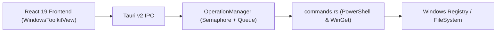

# TRD

- Spec ID: neoget-v2-hardening-and-toolkit
- Status: active
- Owner: NeoGet Team
- Last reviewed: 2026-10-17

## Context

NeoGet v2.2.0 is built on Tauri 2.0 (Rust backend) and React 19 + TypeScript (Vite frontend). Operations are serialized through `OperationManager` (`src-tauri/src/operations.rs`) and system tweaks/cleanups are executed via hidden PowerShell child processes (`CREATE_NO_WINDOW`).

## Proposed architecture

## Interfaces and dependencies

- `get_windows_tweaks() -> Result<Vec<WindowsTweak>, String>`: Returns 19 structured tweaks across categories `Explorateur`, `Interface`, `Apparence`, `Gaming`, `Confidentialite`, `Performance`, `Systeme`, and `Energie`.
- `apply_windows_tweak(manager, id, enabled) -> Result<String, String>`: Acquires exclusive `OperationManager` permit, validates `id` against the known tweak whitelist (`is_supported_windows_tweak_id`), and applies reversible registry/system state changes.
- `scan_cleanup_items() -> Result<Vec<CleanupItem>, String>` and `clean_windows_items(manager, ids) -> Result<String, String>`: Supports `crash_dumps` (`%LOCALAPPDATA%\CrashDumps`, `*.dmp`) in addition to the 6 existing cleanup targets, validated via `is_supported_cleanup_item_id`.
- `export_configuration(items) -> Result<String, String>`: Encodes the validated JSON payload as Base64 and decodes UTF-8 inside PowerShell (`[System.Text.Encoding]::UTF8.GetString([System.Convert]::FromBase64String(...))`) before writing to the user-selected file.

## Security, performance, observability

- Security: All tweak IDs and cleanup IDs are strictly whitelisted in Rust before invoking PowerShell. Configuration export uses Base64 encoding to prevent any PowerShell string interpolation risk.
- Performance: `test_all_winget_commands` is marked `#[ignore]` so `cargo test` runs in < 1s offline while remaining executable on demand via `cargo test -- --ignored`.
- Observability: `OperationManager` and `commands.rs` log actions to `%LOCALAPPDATA%\NeoGet\logs\NeoGet.log` with 5 MB rotation.

## ADR links

- ADR-001: Keep all Windows Toolkit operations whitelisted by static ID in Rust and serialized via `OperationManager::try_exclusive`.
- ADR-002: Encode structured payloads (such as exported JSON configuration) in Base64 when passing to PowerShell file dialogs.
